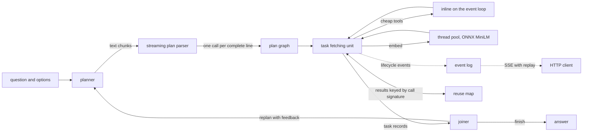
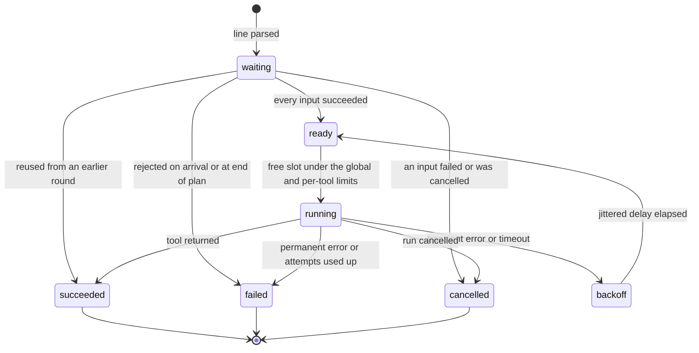

# tool-dag-runtime

An asyncio runtime for the LLMCompiler pattern. A planner writes a numbered plan of
tool calls; an incremental parser hands each call to a task fetching unit the moment
its line is complete, and the unit starts it as soon as the results it reads exist,
while the planner is still writing. When the plan's tasks are done, a joiner either
answers or asks for a new plan, and calls that already ran are reused instead of
repeated. The workload is BIG-bench `movie_recommendation` ("find a movie similar to
A, B, C, D"), answered with real tools: a trigram title resolver, plot lookup,
co-occurrence over MovieLens likers, genre overlap, MiniLM plot embeddings through
ONNX Runtime with a WordPiece tokenizer written here, and a fitted linear scorer. The
baseline is the same plan executed one call at a time in ReAct order.

The planner used in every measurement is a deterministic template planner. A chat-model
planner and joiner are implemented behind an OpenAI-compatible interface and covered
by tests with a scripted fake, but no model was run for any number in this README;
model round trips appear only as structural counts.

Measured on: Intel Core i5-8500 (6 cores), 12 GB RAM, Windows 10, CPU only.
Date: pending benchmark.

## One question, as the service streamed it

`POST /v1/ask` starts a run and streams its lifecycle as server-sent events. The excerpt
below is the raw stream of one real run on the full catalogue, captured by
`tooldag bench --only trace`. Lines starting with `:` are SSE comments added as
annotations; the numbers in them are computed from the same events.

> Pending benchmark. Filled from `bench/results/trace.json` by `uv run tooldag report`.

Timing of the same run, by tool (milliseconds from the start of the run):

> Pending benchmark.

What to look for: compare the `t_ms` of the first `task_started` with that of
`plan_complete`. Everything that started in between ran while the plan was still being
written. In a ReAct loop, each of those tool calls would instead wait for a model call.

### Event types

| event | emitted when |
|---|---|
| `run_started`, `run_finished`, `run_cancelled`, `run_failed` | the run begins and ends |
| `plan_started`, `thought`, `plan_issue`, `plan_join`, `plan_complete`, `plan_error` | the planner's text is parsed; malformed lines become `plan_issue`, not errors |
| `task_received` | a plan line parsed into a call |
| `task_started`, `task_retry`, `task_succeeded`, `task_failed` | an attempt runs, backs off, ends |
| `task_rejected` | unknown tool, wrong arguments, dependency cycle or a reference that is never defined |
| `task_cancelled` | an input failed or the run was cancelled |
| `task_reused` | an earlier round already computed the same call |
| `plan_diff`, `join_decision`, `replan` | the joiner's verdict and what a new round reused |

Every event carries `seq` (also the SSE `id`), `t_ms` since the run started, and the
round. `GET /v1/runs/{id}/events` replays from `Last-Event-ID` and then follows live.

## Inside the task fetching unit



Each task moves through these states:



How the pieces work:

- **Parser** (`plan/parser.py`). `feed()` accepts text chunks of any size, buffers the
  partial line and returns every item whose line is complete. The grammar is
  LLMCompiler's: `3. tool("text", $1, [$2, ${4}], k=0.5)`, `Thought: ...`, `N. join()` or
  `<END_OF_PLAN>`. `$N` inside a string interpolates a result. A line that does not
  parse becomes a `ParseIssue` and the rest of the plan continues. Property tests check
  that every chunking of a plan parses to the same items as the whole text.
- **Graph** (`dag.py`). A call may reference a task number that has not arrived yet; it
  waits. A cycle is found when its closing edge arrives, by searching from the new task
  through the tasks that referenced it early, so plans without forward references pay
  nothing. References still undefined at end of plan fail the tasks that wait on them.
- **Scheduler** (`scheduler.py`). One FIFO queue per tool and a global arrival order;
  the pump starts the oldest ready task among tools under their own limit until the
  global limit is reached, so a saturated `embed` queue never blocks a cheap lookup
  queued behind it. Each attempt has a timeout; transient errors and timeouts are
  retried with exponential backoff and full jitter. A permanent failure cancels every
  dependent, including dependents whose lines arrive later. `cancel()` drops queued
  tasks and pending retries and delivers `CancelledError` to running ones.
- **Tools** (`tools/`). Cheap tools run inline on the loop. `embed` runs on a thread pool
  whose threads are all started before the first dispatch, with one ONNX intra-op
  thread per call, so parallelism comes from running calls side by side
  ([ADR 0002](docs/adr/0002-onnx-threading.md)).
- **Joiner and reuse** (`joiner.py`, `runtime.py`). Every call has a content signature: the
  tool, its literal arguments and the signatures of the tasks it reads. A new round's
  call with a known signature is settled from the earlier result, whatever its number
  ([ADR 0003](docs/adr/0003-content-addressed-reuse.md)).
- **Baseline**. `SequentialExecutor` shares the same bookkeeping, waits for the whole
  plan and runs one call at a time in plan order, as a ReAct agent would.

Hypothesis tests drive both executors with random plans, random arrival gaps, forward
references, cycles, failures and flaky tools, and check that no task starts before its
inputs succeed, that the global and per-tool limits hold, that failures and
cancellation reach every dependent, and that both executors agree on every outcome.

## Sequential against DAG: makespan

Forty held-out questions run under every configuration, with no embedding cache: the
plan embeds the plot of each liked film and each option, so every run makes real ONNX
calls. Configurations are interleaved per question
with a rotating order. "Critical path" is the longest dependency chain weighted by the
busy time each task actually took in that run, a lower bound for any scheduler.

> Pending benchmark. Table from `bench/results/makespan.json`.

Measured on: pending benchmark.

## Does streaming the plan help?

A chat model writes a plan line by line. To measure what dispatching on line
completion buys without a model, the template planner releases each line on a fixed
schedule (5 ms or 25 ms per line, a synthetic pace; no model is run). The comparison
is the same plan with dispatch on each line against dispatch after the last line.

> Pending benchmark. Table from `bench/results/streaming.json`.

Measured on: pending benchmark.

## Picking the right film

Every question runs through the whole runtime. 100 questions (a seeded sample) fit the
scorer weights by conditional logit; the other 400 are held out, and the runtime
answers them with the fitted weights. The other rows rescore the signal values those
same runs computed, splitting ties evenly.

On the original task, the correct option is usually a widely rated film and the
distractors are obscure, so a baseline that ignores the liked films and picks the
most-rated option is reported alongside. The second column uses a variant built here,
not part of BIG-bench: same liked films and answers, with distractors redrawn among
films rated about as often as the answer
([ADR 0004](docs/adr/0004-popularity-matched-variant.md)).

> Pending benchmark. Accuracy table, fitted weights and structural model-call counts
> from `bench/results/accuracy.json`.

Measured on: pending benchmark.

## Bookkeeping cost per task

No-op tools, so the time is the runtime's own: graph checks, readiness, queueing, one
asyncio task per attempt, argument resolution and binding, and the lifecycle events.

> Pending benchmark. Table from `bench/results/overhead.json`.

Measured on: pending benchmark.

## Broken plans and how the loop recovers

Scripted plans with one defect each, on the small fixture catalogue bundled with the
package. Runs offline; `uv run tooldag demo` prints the same scenarios.

> Pending benchmark. Table from `bench/results/replan.json`.

## Running it yourself

Requires [uv](https://docs.astral.sh/uv/). Data goes to `$TOOLDAG_DATA_DIR`
(default `~/.cache/tool-dag-runtime`).

```bash
uv sync

# offline: fixture catalogue, one streamed run and the fault scenarios
uv run tooldag demo

# real data: every file checked against a pinned size and sha256
uv run tooldag fetch
uv run tooldag index          # joins MovieLens and CMU into the catalogue

uv run tooldag ask "Find a movie similar to Heat, Ronin, The Matrix, Pulp Fiction" \
  -o Collateral -o "Notting Hill" -o Babe -o Fargo
uv run tooldag ask "..." -o ... --mode sequential --concurrency 1 --json

# the HTTP service
uv run tooldag serve --port 8080
curl -N -X POST localhost:8080/v1/ask -H 'Content-Type: application/json' \
  -d '{"question": "Find a movie similar to Heat, Ronin", "options": ["Collateral", "Babe"]}'

# every benchmark (writes bench/results/*.json), then the README tables
uv run tooldag bench
uv run tooldag report
```

`tooldag bench --smoke` runs a small subset of every benchmark and names its files
`smoke-*.json`. `tooldag bench --only makespan` (or `accuracy`, `streaming`,
`overhead`, `replan`, `trace`) runs one benchmark. The accuracy benchmark writes the
fitted weights to `$TOOLDAG_DATA_DIR/scorer_weights.json`, which `ask` and `serve`
then use; before that they score with equal weights.

With Docker (the image falls back to the fixture catalogue when nothing is mounted;
mount a data directory prepared by `tooldag fetch` and `tooldag index`):

```bash
docker build -t tool-dag-runtime .
docker run --rm -p 8080:8080 tool-dag-runtime
docker run --rm -p 8080:8080 -v ~/.cache/tool-dag-runtime:/data tool-dag-runtime
docker run --rm tool-dag-runtime demo
```

The container runs as uid 10001 and reports health from `/healthz`.

### HTTP endpoints

| method and path | does |
|---|---|
| `GET /healthz` | liveness, loaded catalogue, embedder and scorer |
| `GET /v1/tools` | tool signatures and descriptions, as given to a planner |
| `POST /v1/runs` | start a run, returns `run_id` and the event URL (201) |
| `GET /v1/runs/{id}` | state, answer, makespan, structural model-call counts |
| `GET /v1/runs/{id}/events` | SSE, replay from `Last-Event-ID` or `?after=N`, then live |
| `DELETE /v1/runs/{id}` | cancel; running tools receive `CancelledError` |
| `POST /v1/ask` | start a run and stream it in the response; disconnecting cancels it |

A run request takes `question`, `options`, `planner` (`template` or `llm`), `joiner`
(`rule` or `llm`), `mode` (`dag` or `sequential`), `max_concurrency` and `max_rounds`.

### Plugging in a chat model (not run here)

`--planner llm --joiner llm` (or the same fields in a run request) send the planner and
joiner prompts to any OpenAI-compatible `/chat/completions` endpoint with streaming:
OpenAI, Ollama, vLLM, LM Studio or a llama.cpp server. Configure it with
`TOOLDAG_LLM_BASE_URL` (for example `http://localhost:11434/v1`), `TOOLDAG_LLM_MODEL`
and, if needed, `TOOLDAG_LLM_API_KEY`. The token stream goes straight into the parser,
so tasks start while the model is writing. This path is tested against a scripted
fake provider and a local stand-in server; its accuracy and latency were not measured.

## Downloads and licences

`tooldag fetch` downloads these files and checks each against the size and sha256
recorded on first download (`src/tooldag/fetch.py`). None of them is stored in this
repository.

| file | source | licence | used for |
|---|---|---|---|
| BIG-bench `movie_recommendation/task.json` | github.com/google/BIG-bench, pinned commit | Apache-2.0 | the 500 questions |
| MovieLens `ml-latest-small.zip` | files.grouplens.org | GroupLens usage licence: research use, no redistribution | titles, genres, ratings for resolution and co-occurrence |
| CMU Movie Summary Corpus `MovieSummaries.tar.gz` | cs.cmu.edu/~ark/personas | CC BY-SA | Wikipedia plot summaries |
| all-MiniLM-L6-v2, int8 ONNX export, `vocab.txt`, `tokenizer.json` | huggingface.co/Xenova/all-MiniLM-L6-v2, pinned revision | Apache-2.0 | plot embeddings; `tokenizer.json` only for the tokenizer parity test |

The ONNX file is the community export of `sentence-transformers/all-MiniLM-L6-v2`
published in the Xenova repository; the pinned revision and checksum identify the
exact file. Because the MovieLens licence forbids redistribution, the catalogue built
from it lives only in the data directory. The code is MIT licensed (`LICENSE`).

## Known gaps

- **No model in the loop.** Every measured run uses the template planner and the rule
  joiner. How fast a real model writes plans, how often it writes broken ones and how
  accurate its joiner is were not measured; the streaming experiment uses synthetic
  pacing and model calls are counted, not made.
- **The task rewards popularity.** On the original BIG-bench set, picking the most-rated
  option is a strong baseline, and the co-occurrence signal is computed from the same
  MovieLens ratings that define popularity, so it is not independent of it even on
  the popularity-matched variant. The variant is this repository's construction.
- **Plot coverage.** Not every MovieLens film has a CMU plot summary; those candidates
  get no plot vector and are scored at the fitting-split mean for that signal.
- **One machine, one process.** All timings come from one Windows desktop CPU. The event
  loop is single-threaded; the pure-Python tokenizer holds the GIL on worker threads
  while it runs, and on Windows sleeps and timers have coarse granularity.
- **Service scope.** Runs are kept in memory and finished runs are evicted past a fixed
  cap; there is no authentication or persistence, and one process serves everything.

## Code layout

```text
src/tooldag/
  plan/        parser, AST and renderer for the plan language
  dag.py       incremental graph: forward references, cycles, signatures
  scheduler.py task fetching unit and the sequential baseline
  runtime.py   plan, execute, join, replan
  joiner.py    rule and chat-model joiners, plan diffing
  planners/    template, scripted and chat-model planners
  providers/   OpenAI-compatible streaming client and scripted fake
  tools/       catalogue, title index, WordPiece, embedder, scorer, movie tools
  server.py    aiohttp service with SSE
  bench/       benchmarks, provenance and the report renderer
tests/         default suite; tests/test_integration.py needs fetched data
docs/adr/      decision records
```

## Checking it

```bash
uv run ruff check . && uv run ruff format --check .
uv run pytest                    # default suite: no network, no downloads
uv run pytest -m integration     # checksums, tokenizer parity, MiniLM, title coverage
```

The integration tests compare the WordPiece tokenizer token for token with the
reference `tokenizers` implementation on plot summaries and titles from the catalogue;
`tokenizers` is a test-only dependency and is never imported by the package.
