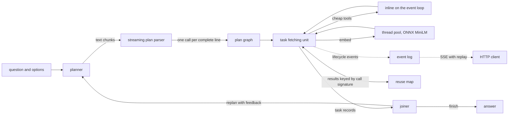
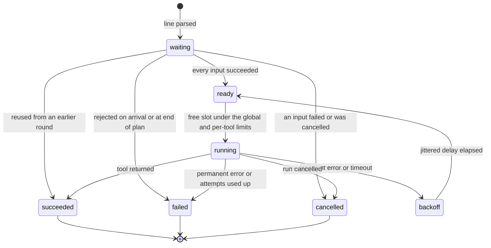

# tool-dag-runtime

[](https://github.com/daniellopez882/tool-dag-runtime/actions/workflows/ci.yml)  

An asyncio runtime for the LLMCompiler pattern. A planner writes a numbered plan of
tool calls; an incremental parser hands each call to a task fetching unit the moment
its line is complete, and the unit starts it as soon as the results it reads exist,
while the planner is still writing. When the plan's tasks are done, a joiner either
answers or asks for a new plan, and calls that already ran are reused instead of
repeated. The workload is BIG-bench `movie_recommendation` ("find a movie similar to
A, B, C, D"), answered with real tools: a trigram title resolver, plot lookup,
co-occurrence over MovieLens likers, genre overlap, MiniLM plot embeddings through
ONNX Runtime with a WordPiece tokenizer written here, and a fitted linear scorer. The
baseline is the same plan executed one call at a time in ReAct order.

The planner used in every measurement is a deterministic template planner. A chat-model
planner and joiner are implemented behind an OpenAI-compatible interface and covered
by tests with a scripted fake, but no model was run for any number in this README;
model round trips appear only as structural counts.

Measured on: Intel Core i5-8500 (6 cores), 12 GB RAM, Windows 10, CPU only, Python
3.12.14, onnxruntime 1.31.0, on 2026-10-13 at commit `b00410c8e187`. Every number in
this README is copied from `bench/results/*.json`; each file also records the machine,
package versions, date, commit and command. To reproduce, with the data fetched and
indexed (see [Running it yourself](#running-it-yourself)):

```bash
export TOOLDAG_DATA_DIR=/path/to/data   # default ~/.cache/tool-dag-runtime
uv run tooldag bench                    # every benchmark, writes bench/results/*.json
uv run tooldag report                   # prints the tables below from those files
```

## One question, as the service streamed it

`POST /v1/ask` starts a run and streams its lifecycle as server-sent events. The excerpt
below is the raw stream of one real run on the full catalogue, captured by
`tooldag bench --only trace`. Lines starting with `:` are SSE comments added as
annotations; the numbers in them are computed from the same events.

The question is the first held-out BIG-bench item, answered with the fitted scorer
and the template planner, at a global concurrency limit of 6.

```text
: the question and its four options arrive
id: 1
event: run_started
data: {"run_id":"3eea21e7d6f7","seq":1,"t_ms":0.412,"type":"run_started","round":null,"data":{"question":"Find a movie similar to Mission Impossible, The Sil...

: ... 2 more events ...

: the planner has written line 1 of 37
id: 4
event: task_received
data: {"run_id":"3eea21e7d6f7","seq":4,"t_ms":8.842,"type":"task_received","round":1,"data":{"idx":1,"tool":"resolve_title","deps":[],"call":"1. resolve_titl...

: dispatched at once; 36 plan lines are still to come
id: 5
event: task_started
data: {"run_id":"3eea21e7d6f7","seq":5,"t_ms":8.898,"type":"task_started","round":1,"data":{"idx":1,"tool":"resolve_title","attempt":1,"waited_ms":0.01}}

: ... 5 more events ...

: first ONNX call starts with 34 lines unwritten
id: 11
event: task_started
data: {"run_id":"3eea21e7d6f7","seq":11,"t_ms":10.157,"type":"task_started","round":1,"data":{"idx":3,"tool":"embed","attempt":1,"waited_ms":0.006}}

: ... 64 more events ...

: plan finished at 41.372 ms; 14 tasks had already succeeded
id: 76
event: plan_complete
data: {"run_id":"3eea21e7d6f7","seq":76,"t_ms":41.372,"type":"plan_complete","round":1,"data":{"tasks":37,"issues":0,"join_seen":true}}

: ... 39 more events ...

: the weighted scorer's ranking of the options
id: 116
event: task_succeeded
data: {"run_id":"3eea21e7d6f7","seq":116,"t_ms":166.083,"type":"task_succeeded","round":1,"data":{"idx":37,"tool":"rank","attempts":1,"busy_ms":0.225,"result...

: the joiner accepts the ranking instead of replanning
id: 117
event: join_decision
data: {"run_id":"3eea21e7d6f7","seq":117,"t_ms":166.248,"type":"join_decision","round":1,"data":{"action":"finish","answer":"Austin Powers: International Man...

: structural count: 2 model calls as LLMCompiler, 38 as ReAct (no model was run)
id: 118
event: run_finished
data: {"run_id":"3eea21e7d6f7","seq":118,"t_ms":166.334,"type":"run_finished","round":null,"data":{"answer":"Austin Powers: International Man of Mystery","ro...
```

Timing of the same run, by tool (milliseconds from the start of the run):

| tool | tasks | first line parsed (ms) | first started (ms) | last finished (ms) |
|---|---:|---:|---:|---:|
| resolve_title | 8 | 8.842 | 8.898 | 50.996 |
| plot | 8 | 9.11 | 9.149 | 52.135 |
| embed | 8 | 10.12 | 10.157 | 164.998 |
| cooccurrence | 4 | 25.627 | 25.686 | 52.341 |
| genre_jaccard | 4 | 26.101 | 26.149 | 52.612 |
| plot_similarity | 4 | 26.479 | 163.689 | 165.271 |
| rank | 1 | 41.177 | 165.495 | 166.083 |

<details>
<summary>All 37 tasks of the run</summary>

| task | tool | line parsed (ms) | started (ms) | finished (ms) |
|---:|---|---:|---:|---:|
| $1 | resolve_title | 8.842 | 8.898 | 9.055 |
| $2 | plot | 9.11 | 9.149 | 10.061 |
| $3 | embed | 10.12 | 10.157 | 129.78 |
| $4 | resolve_title | 10.38 | 10.43 | 12.781 |
| $5 | plot | 12.849 | 12.889 | 13.073 |
| $6 | embed | 13.132 | 13.17 | 154.466 |
| $7 | resolve_title | 13.515 | 13.557 | 13.732 |
| $8 | plot | 13.785 | 13.823 | 17.229 |
| $9 | embed | 17.338 | 17.394 | 142.454 |
| $10 | resolve_title | 17.85 | 18.045 | 20.365 |
| $11 | plot | 20.498 | 20.566 | 20.83 |
| $12 | embed | 20.913 | 20.961 | 163.451 |
| $13 | resolve_title | 21.38 | 21.43 | 24.431 |
| $14 | plot | 24.611 | 24.691 | 25.108 |
| $15 | embed | 25.231 | 25.276 | 149.516 |
| $16 | cooccurrence | 25.627 | 25.686 | 26.014 |
| $17 | genre_jaccard | 26.101 | 26.149 | 26.356 |
| $18 | plot_similarity | 26.479 | 163.689 | 164.056 |
| $19 | resolve_title | 26.807 | 26.852 | 27.159 |
| $20 | plot | 27.284 | 27.344 | 35.047 |
| $21 | embed | 35.315 | 35.393 | 48.769 |
| $22 | cooccurrence | 35.955 | 48.884 | 49.147 |
| $23 | genre_jaccard | 36.345 | 49.262 | 49.962 |
| $24 | plot_similarity | 37.006 | 163.741 | 164.166 |
| $25 | resolve_title | 37.398 | 50.027 | 50.223 |
| $26 | plot | 37.949 | 51.121 | 51.34 |
| $27 | embed | 38.424 | 52.651 | 164.998 |
| $28 | cooccurrence | 38.998 | 51.387 | 51.67 |
| $29 | genre_jaccard | 39.279 | 51.711 | 51.875 |
| $30 | plot_similarity | 39.456 | 165.09 | 165.271 |
| $31 | resolve_title | 39.827 | 50.423 | 50.996 |
| $32 | plot | 40.023 | 51.91 | 52.135 |
| $33 | embed | 40.231 | 129.939 | 130.737 |
| $34 | cooccurrence | 40.401 | 52.185 | 52.341 |
| $35 | genre_jaccard | 40.632 | 52.375 | 52.612 |
| $36 | plot_similarity | 40.866 | 163.788 | 164.235 |
| $37 | rank | 41.177 | 165.495 | 166.083 |

</details>

Measured on: Intel Core i5-8500, 6 cores, 12 GB RAM, Windows 10, CPU only; 2026-10-13,
commit `b00410c8e187`; `bench/results/trace.json`.

What to look for: compare the `t_ms` of the first `task_started` with that of
`plan_complete`. Everything that started in between ran while the plan was still being
written. In a ReAct loop, each of those tool calls would instead wait for a model call.
Here the first lookup started at 8.898 ms and the first ONNX call at 10.157 ms; the plan
was complete at 41.372 ms and the answer was out at 166.264 ms. The run is bound by the
eight `embed` calls: every call that does not read an embedding was done by 52.612 ms.

The trace also shows a cost of the single global limit. No per-tool limit was set, so
while six `embed` calls held all six slots, cheap calls parsed in that window waited:
`$25` was parsed at 37.398 ms but started at 50.027 ms, after `$21` gave its slot back
at 48.769 ms. `$21` embeds an option that has no plot summary, so it never runs the
model, yet its worker thread was busy for 12.975 ms among five threads running MiniLM.
A per-tool cap on `embed` (`Limits(per_tool={"embed": 5})`) is the knob for the
waiting; no measured run set one.

### Event types

| event | emitted when |
|---|---|
| `run_started`, `run_finished`, `run_cancelled`, `run_failed` | the run begins and ends |
| `plan_started`, `thought`, `plan_issue`, `plan_join`, `plan_complete`, `plan_error` | the planner's text is parsed; malformed lines become `plan_issue`, not errors |
| `task_received` | a plan line parsed into a call |
| `task_started`, `task_retry`, `task_succeeded`, `task_failed` | an attempt runs, backs off, ends |
| `task_rejected` | unknown tool, wrong arguments, dependency cycle or a reference that is never defined |
| `task_cancelled` | an input failed or the run was cancelled |
| `task_reused` | an earlier round already computed the same call |
| `plan_diff`, `join_decision`, `replan` | the joiner's verdict and what a new round reused |

Every event carries `seq` (also the SSE `id`), `t_ms` since the run started, and the
round. `GET /v1/runs/{id}/events` replays from `Last-Event-ID` and then follows live.

## Inside the task fetching unit



Each task moves through these states:



How the pieces work:

- **Parser** (`plan/parser.py`). `feed()` accepts text chunks of any size, buffers the
  partial line and returns every item whose line is complete. The grammar is
  LLMCompiler's: `3. tool("text", $1, [$2, ${4}], k=0.5)`, `Thought: ...`, `N. join()` or
  `<END_OF_PLAN>`. `$N` inside a string interpolates a result. A line that does not
  parse becomes a `ParseIssue` and the rest of the plan continues. Property tests check
  that every chunking of a plan parses to the same items as the whole text.
- **Graph** (`dag.py`). A call may reference a task number that has not arrived yet; it
  waits. A cycle is found when its closing edge arrives, by searching from the new task
  through the tasks that referenced it early, so plans without forward references pay
  nothing. References still undefined at end of plan fail the tasks that wait on them.
- **Scheduler** (`scheduler.py`). One FIFO queue per tool and a global arrival order;
  the pump starts the oldest ready task among tools under their own limit until the
  global limit is reached, so a backlog of `embed` calls at their own limit never blocks
  a cheap lookup queued behind it (running calls still hold global slots, as the trace
  above shows). Each attempt has a timeout; transient errors and timeouts are
  retried with exponential backoff and full jitter. A permanent failure cancels every
  dependent, including dependents whose lines arrive later. `cancel()` drops queued
  tasks and pending retries and delivers `CancelledError` to running ones.
- **Tools** (`tools/`). Cheap tools run inline on the loop. `embed` runs on a thread pool
  whose threads are all started before the first dispatch, with one ONNX intra-op
  thread per call, so parallelism comes from running calls side by side
  ([ADR 0002](docs/adr/0002-onnx-threading.md)).
- **Joiner and reuse** (`joiner.py`, `runtime.py`). Every call has a content signature: the
  tool, its literal arguments and the signatures of the tasks it reads. A new round's
  call with a known signature is settled from the earlier result, whatever its number
  ([ADR 0003](docs/adr/0003-content-addressed-reuse.md)).
- **Baseline**. `SequentialExecutor` shares the same bookkeeping, waits for the whole
  plan and runs one call at a time in plan order, as a ReAct agent would.

Hypothesis tests drive both executors with random plans, random arrival gaps, forward
references, cycles, failures and flaky tools, and check that no task starts before its
inputs succeed, that the global and per-tool limits hold, that failures and
cancellation reach every dependent, and that both executors agree on every outcome.

## Sequential against DAG: makespan

Forty held-out questions run under every configuration, with no embedding cache: the
plan embeds the plot of each liked film and each option, so every run makes real ONNX
calls. Configurations are interleaved per question with a rotating order, after two
warm-up questions that are not recorded. "Critical path" is the longest dependency
chain weighted by the busy time each task actually took in that run, a lower bound for
any scheduler given those task times. All six configurations gave the same answer on
every question.

| configuration | makespan p50 (ms) | p95 (ms) | speedup at p50 | critical path p50 (ms) | one embed call p50 (ms) |
|---|---:|---:|---:|---:|---:|
| sequential (ReAct order) | 430.6 | 562.7 | 1.00x | 67.3 | 58.6 |
| sequential, ONNX 6 intra-op threads | 250.4 | 378.3 | 1.72x | 50.0 | 30.2 |
| DAG, concurrency 1 | 439.5 | 620.3 | 0.98x | 71.0 | 60.0 |
| DAG, concurrency 2 | 262.9 | 344.4 | 1.64x | 78.2 | 66.9 |
| DAG, concurrency 4 | 181.3 | 220.5 | 2.38x | 101.8 | 90.6 |
| DAG, concurrency 6 | 183.1 | 240.7 | 2.35x | 147.2 | 118.2 |

Measured on: Intel Core i5-8500, 6 cores, 12 GB RAM, Windows 10, CPU only; 2026-10-13,
commit `b00410c8e187`; `bench/results/makespan.json`.

- **Dispatching by dependency, at concurrency 4, cut the median from 430.6 ms to
  181.3 ms (2.38x).** At concurrency 1 the DAG executor runs the same calls one at a
  time and lands where the sequential baseline does (439.5 ms, 0.98x), so the gain comes
  from overlapping calls, not from a cheaper code path.
- **Concurrency 6 bought nothing over 4** (183.1 ms, 2.35x). One `embed` call takes
  58.6 ms at the median when it runs alone and 118.2 ms when six run side by side: on
  six cores the extra calls slow each other down instead of adding throughput. Where
  that time goes (memory bandwidth, the tokenizer's time under the GIL, the event loop)
  was not broken down.
- **Giving ONNX the cores inside each call is the other option.** The sequential
  baseline with six intra-op threads reaches 250.4 ms (1.72x): slightly ahead of the DAG
  at concurrency 2 (262.9 ms), behind it at 4 and 6
  ([ADR 0002](docs/adr/0002-onnx-threading.md)). Combining both
  (several intra-op threads per call and several calls at once) was not measured.
- The critical path rises with concurrency (67.3 ms to 147.2 ms) for the same reason
  the embed time does: contention stretches each task, so the lower bound itself moves.

## Does streaming the plan help?

A chat model writes a plan line by line. To measure what dispatching on line
completion buys without a model, the template planner releases each line on a fixed
schedule (5 ms or 25 ms per line, a synthetic pace; no model is run). The comparison
is the same plan with dispatch on each line against dispatch after the last line.
Fifteen held-out questions, global concurrency 6, real ONNX calls.

| configuration | makespan p50 (ms) | plan complete p50 (ms) | first task started p50 (ms) | work left after plan p50 (ms) |
|---|---:|---:|---:|---:|
| stream dispatch, 5 ms/line | 223.4 | 194.1 | 15.3 | 25.7 |
| plan then execute, 5 ms/line | 377.7 | 203.1 | 203.2 | 171.2 |
| stream dispatch, 25 ms/line | 989.1 | 989.0 | 68.4 | 0.1 |
| plan then execute, 25 ms/line | 1167.8 | 984.3 | 984.4 | 172.3 |
| stream dispatch, chat-model token stream | not run | not run | not run | not run |

Measured on: Intel Core i5-8500, 6 cores, 12 GB RAM, Windows 10, CPU only; 2026-10-13,
commit `b00410c8e187`; `bench/results/streaming.json`.

At 5 ms per line, dispatching on each line finished at 223.4 ms against 377.7 ms when
the executor waited for the whole plan: only 25.7 ms of work was left once the last
line arrived, against 171.2 ms. At 25 ms per line the plan itself takes about a second
(989.0 ms), and with streaming dispatch the tool work finished inside it: 0.1 ms
remained after the last line, so the makespan is the planning time; waiting for the
plan left 172.3 ms of work after it (makespan 1167.8 ms). How fast a real model writes
these plans, and so which row it would resemble, was not measured.

## Picking the right film

Every question runs through the whole runtime. 100 questions (a seeded sample) fit the
scorer weights by conditional logit; the other 400 are held out, and the runtime
answers them with the fitted weights. The other rows rescore the signal values those
same runs computed, splitting ties evenly.

On the original task, the correct option is usually a widely rated film and the
distractors are obscure, so a baseline that ignores the liked films and picks the
most-rated option is reported alongside. The second column uses a variant built here,
not part of BIG-bench: same liked films and answers, with distractors redrawn among
films rated about as often as the answer
([ADR 0004](docs/adr/0004-popularity-matched-variant.md)).

Accuracy on the 400 held-out questions, with 95% Wilson intervals:

| scorer | BIG-bench movie_recommendation (400 held out) | popularity-matched variant (400 held out) |
|---|---:|---:|
| random choice (expected) | 25.0% (21.0% to 29.5%) | 25.0% (21.0% to 29.5%) |
| most-rated option | 99.0% (97.5% to 99.6%) | 39.6% (34.9% to 44.5%) |
| cooccurrence only | 99.8% (98.6% to 100.0%) | 62.0% (57.1% to 66.6%) |
| plot_similarity only | 34.8% (30.2% to 39.5%) | 33.2% (28.8% to 38.0%) |
| genre_jaccard only | 47.1% (42.3% to 52.0%) | 42.2% (37.5% to 47.1%) |
| equal weights, raw signals | 92.0% (88.9% to 94.3%) | 49.5% (44.6% to 54.4%) |
| fitted, without co-occurrence (ablation) | 47.0% (42.2% to 51.9%) | 41.0% (36.3% to 45.9%) |
| fitted, all three signals | 99.8% (98.6% to 100.0%) | 61.3% (56.4% to 65.9%) |
| runtime answer (fitted scorer) | 99.8% (98.6% to 100.0%) | 61.3% (56.4% to 65.9%) |
| chat-model planner and joiner (`--planner llm --joiner llm`) | not run | not run |

Measured on: Intel Core i5-8500, 6 cores, 12 GB RAM, Windows 10, CPU only; 2026-10-13,
commit `b00410c8e187`; `bench/results/accuracy.json`.

- **On BIG-bench as published, popularity alone nearly solves the task.** The
  most-rated option is right 99.0% of the time without looking at the liked films.
  Co-occurrence alone and the fitted scorer both reach 99.8%, which is no evidence that
  they measure similarity rather than popularity.
- **With popularity controlled, co-occurrence carries the scorer.** On the
  popularity-matched variant the most-rated baseline falls to 39.6%. Co-occurrence alone
  reaches 62.0%; the fitted three-signal scorer reaches 61.3%, so adding plot and genre
  signals did not help on held-out questions. Genre overlap alone gets 42.2% and plot
  similarity 33.2%, not far above chance (25.0%).
- **Ablation.** Without co-occurrence, the refitted scorer gets 47.0% on BIG-bench and
  41.0% on the variant.
- The runtime's own answers match the offline rescoring of the same signals in both
  columns: the joiner returns the fitted scorer's choice.

Fitted weights (conditional logit on standardised signals, 100 questions each):

| dataset | cooccurrence | plot_similarity | genre_jaccard |
|---|---:|---:|---:|
| BIG-bench movie_recommendation | +2.887 | -0.037 | +0.291 |
| popularity-matched variant | +2.027 | +0.108 | +0.202 |

The plot-similarity weight is close to zero on BIG-bench (-0.037). On the held-out
BIG-bench questions, 328 candidates had no CMU plot summary and so no plot vector; on
the variant, 21.

Model calls are counted, not made. For the same plans, an LLMCompiler run needs one
planner and one joiner call per round; a ReAct agent needs one call per tool call plus
one to answer:

| per held-out BIG-bench question | value |
|---|---:|
| tool tasks executed (mean) | 37.0 |
| questions that needed a replan | 0 |
| model calls, LLMCompiler (planner + joiner per round) | 2.0 |
| model calls, ReAct equivalent (one per tool call + answer) | 38.0 |

## Bookkeeping cost per task

No-op tools, so the time is the runtime's own: graph checks, readiness, queueing, one
asyncio task per attempt, argument resolution and binding, and the lifecycle events.
Each row is the median of 15 timed drains after one warm-up; the parser row is the
median of 500 parses.

| plan shape | executor | us per task (median) | events per task |
|---|---|---:|---:|
| 2000 independent tasks | dag | 70.64 | 3.0 |
| 2000 independent tasks | sequential | 77.78 | 3.0 |
| chain of 2000 tasks | dag | 89.54 | 3.0 |
| chain of 2000 tasks | sequential | 128.73 | 3.0 |
| template plan shape (34 tasks) | dag | 103.81 | 3.0 |
| template plan shape (34 tasks) | sequential | 103.29 | 3.0 |
| parser, 34-line plan in 7-char chunks | - | 12.5 per line | - |

Measured on: Intel Core i5-8500, 6 cores, 12 GB RAM, Windows 10, CPU only; 2026-10-13,
commit `b00410c8e187`; `bench/results/overhead.json`.

On the shape of the real plan, the runtime spends 103.81 µs per task, against a median
`embed` call of 58.6 ms in the sequential makespan runs. Per-task cost does not grow
from the 34-task plan to 2,000 independent tasks (70.64 µs) or a 2,000-task chain
(89.54 µs), so the cycle check and readiness tracking stay cheap on long plans. The
sequential executor is no cheaper per task: both pay for the same graph and the same
three events per task.

## Broken plans and how the loop recovers

Scripted plans with one defect each, on the small fixture catalogue bundled with the
package. Runs offline; `uv run tooldag demo` prints the same scenarios. The planner
is scripted and the joiner is the rule joiner; no model is run. "Tasks run" counts
tool executions over all rounds, "tasks reused" the calls a later round settled from
an earlier round's result.

| scenario | defect | rounds | tasks run | tasks reused | retries | answer |
|---|---|---:|---:|---:|---:|---|
| clean template plan | - | 1 | 34 | 0 | 0 | Comet Wardens |
| malformed line | round 1 has a call without its closing parenthesis | 2 | 34 | 32 | 0 | Comet Wardens |
| dependency cycle | two signal tasks wait on each other | 2 | 34 | 31 | 0 | Comet Wardens |
| dangling reference | rank() reads $99, which is never defined | 2 | 34 | 33 | 0 | Comet Wardens |
| unknown tool | one call names a tool that does not exist | 2 | 34 | 32 | 0 | Comet Wardens |
| transient tool failure | embed() fails twice with a retryable error | 1 | 34 | 0 | 2 | Comet Wardens |
| unknown title | the question names a film the catalogue lacks | 2 | 35 | 21 | 0 | Comet Wardens |
| never recovers | every round's plan is malformed; the joiner gives up | 3 | 32 | 64 | 0 | none |
| any scenario with a chat-model planner and joiner | - | not run | not run | not run | not run | not run |

Measured on: Intel Core i5-8500, 6 cores, 12 GB RAM, Windows 10, CPU only; 2026-10-13,
commit `b00410c8e187`; `bench/results/replan.json`.

Every scenario ended as expected: seven reached the right answer and the last gave up
after three rounds. A broken line costs one extra round, and the second round
re-executes only what the defect touched; the rest is reused by signature. A transient
failure never reaches the joiner: the scheduler retries it inside the round.

## Running it yourself

Requires [uv](https://docs.astral.sh/uv/). Data goes to `$TOOLDAG_DATA_DIR`
(default `~/.cache/tool-dag-runtime`).

```bash
uv sync

# offline: fixture catalogue, one streamed run and the fault scenarios
uv run tooldag demo

# real data: every file checked against a pinned size and sha256
uv run tooldag fetch
uv run tooldag index          # joins MovieLens and CMU into the catalogue

uv run tooldag ask "Find a movie similar to Heat, Ronin, The Matrix, Pulp Fiction" \
  -o Collateral -o "Notting Hill" -o Babe -o Fargo
uv run tooldag ask "Find a movie similar to Heat, Ronin" -o Collateral -o Babe   --mode sequential --json   # ReAct-order baseline, raw events as JSON lines

# the HTTP service
uv run tooldag serve --port 8080
curl -N -X POST localhost:8080/v1/ask -H 'Content-Type: application/json' \
  -d '{"question": "Find a movie similar to Heat, Ronin", "options": ["Collateral", "Babe"]}'

# every benchmark (writes bench/results/*.json), then the README tables
uv run tooldag bench
uv run tooldag report
```

`tooldag bench --smoke` runs a small subset of every benchmark and names its files
`smoke-*.json`. `tooldag bench --only makespan` (or `accuracy`, `streaming`,
`overhead`, `replan`, `trace`) runs one benchmark. The accuracy benchmark writes the
fitted weights to `$TOOLDAG_DATA_DIR/scorer_weights.json`, which `ask` and `serve`
then use; before that they score with equal weights.

With Docker (the image falls back to the fixture catalogue when nothing is mounted;
mount a data directory prepared by `tooldag fetch` and `tooldag index`):

```bash
docker build -t tool-dag-runtime .
docker run --rm -p 8080:8080 tool-dag-runtime
docker run --rm -p 8080:8080 -v ~/.cache/tool-dag-runtime:/data tool-dag-runtime
docker run --rm tool-dag-runtime demo
```

The container runs as uid 10001 and reports health from `/healthz`.

### HTTP endpoints

| method and path | does |
|---|---|
| `GET /healthz` | liveness, loaded catalogue, embedder and scorer |
| `GET /v1/tools` | tool signatures and descriptions, as given to a planner |
| `POST /v1/runs` | start a run, returns `run_id` and the event URL (201) |
| `GET /v1/runs/{id}` | state, answer, makespan, structural model-call counts |
| `GET /v1/runs/{id}/events` | SSE, replay from `Last-Event-ID` or `?after=N`, then live |
| `DELETE /v1/runs/{id}` | cancel; running tools receive `CancelledError` |
| `POST /v1/ask` | start a run and stream it in the response; disconnecting cancels it |

A run request takes `question`, `options`, `planner` (`template` or `llm`), `joiner`
(`rule` or `llm`), `mode` (`dag` or `sequential`), `max_concurrency` and `max_rounds`.

### Plugging in a chat model (not run here)

`--planner llm --joiner llm` (or the same fields in a run request) send the planner and
joiner prompts to any OpenAI-compatible `/chat/completions` endpoint with streaming:
OpenAI, Ollama, vLLM, LM Studio or a llama.cpp server. Configure it with
`TOOLDAG_LLM_BASE_URL` (for example `http://localhost:11434/v1`), `TOOLDAG_LLM_MODEL`
and, if needed, `TOOLDAG_LLM_API_KEY`. The token stream goes straight into the parser,
so tasks start while the model is writing. This path is tested against a scripted
fake provider and a local stand-in server; its accuracy and latency were not measured.

## Downloads and licences

`tooldag fetch` downloads these files and checks each against the size and sha256
recorded on first download (`src/tooldag/fetch.py`). None of them is stored in this
repository.

| file | source | licence | used for |
|---|---|---|---|
| BIG-bench `movie_recommendation/task.json` | github.com/google/BIG-bench, pinned commit | Apache-2.0 | the 500 questions |
| MovieLens `ml-latest-small.zip` | files.grouplens.org | GroupLens usage licence: research use, no redistribution | titles, genres, ratings for resolution and co-occurrence |
| CMU Movie Summary Corpus `MovieSummaries.tar.gz` | cs.cmu.edu/~ark/personas | CC BY-SA | Wikipedia plot summaries |
| all-MiniLM-L6-v2, int8 ONNX export, `vocab.txt`, `tokenizer.json` | huggingface.co/Xenova/all-MiniLM-L6-v2, pinned revision | Apache-2.0 | plot embeddings; `tokenizer.json` only for the tokenizer parity test |

The ONNX file is the community export of `sentence-transformers/all-MiniLM-L6-v2`
published in the Xenova repository; the pinned revision and checksum identify the
exact file. Because the MovieLens licence forbids redistribution, the catalogue built
from it lives only in the data directory. The code is MIT licensed (`LICENSE`).

## Known gaps

- **No model in the loop.** Every measured run uses the template planner and the rule
  joiner. How fast a real model writes plans, how often it writes broken ones and how
  accurate its joiner is were not measured; the streaming experiment uses synthetic
  pacing and model calls are counted, not made.
- **The task rewards popularity.** On the original BIG-bench set, picking the most-rated
  option scores 99.0%, and the co-occurrence signal is computed from the same
  MovieLens ratings that define popularity, so it is not independent of it even on
  the popularity-matched variant. The variant is this repository's construction.
- **The other two signals add little.** On the variant the fitted three-signal scorer
  (61.3%) did not beat co-occurrence alone (62.0%); plot similarity from MiniLM is
  close to chance on its own.
- **Small timing samples.** Makespan rows are 40 questions and streaming rows 15, one
  run each per configuration; p95 values rest on two or three runs at the tail.
- **Plot coverage.** Not every MovieLens film has a CMU plot summary; those candidates
  get no plot vector and are scored at the fitting-split mean for that signal.
- **One machine, one process.** All timings come from one Windows desktop CPU. The event
  loop is single-threaded; the pure-Python tokenizer holds the GIL on worker threads
  while it runs, and on Windows sleeps and timers have coarse granularity.
- **Service scope.** Runs are kept in memory and finished runs are evicted past a fixed
  cap; there is no authentication or persistence, and one process serves everything.

## Code layout

```text
src/tooldag/
  plan/        parser, AST and renderer for the plan language
  dag.py       incremental graph: forward references, cycles, signatures
  scheduler.py task fetching unit and the sequential baseline
  runtime.py   plan, execute, join, replan
  joiner.py    rule and chat-model joiners, plan diffing
  planners/    template, scripted and chat-model planners
  providers/   OpenAI-compatible streaming client and scripted fake
  tools/       catalogue, title index, WordPiece, embedder, scorer, movie tools
  server.py    aiohttp service with SSE
  bench/       benchmarks, provenance and the report renderer
tests/         default suite; tests/test_integration.py needs fetched data
docs/adr/      decision records
```

## Checking it

```bash
uv run ruff check . && uv run ruff format --check .
uv run pytest                    # default suite: no network, no downloads
uv run pytest -m integration     # checksums, tokenizer parity, MiniLM, title coverage
```

The integration tests compare the WordPiece tokenizer token for token with the
reference `tokenizers` implementation on plot summaries and titles from the catalogue;
`tokenizers` is a test-only dependency and is never imported by the package.
